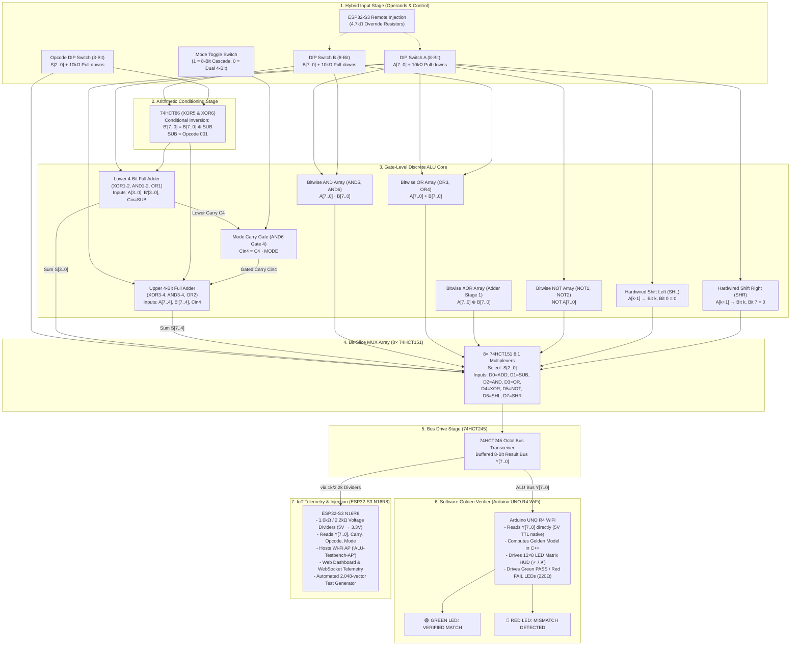

# Complete Hardware Circuit Schematic & Netlist
## Reconfigurable 8-Bit / 4-Bit Gate-Level Discrete ALU with ESP32-S3 Web Dashboard & Arduino UNO R4 WiFi Software Verifier

---

## 1. High-Level Architectural Schematic



---

## 2. System Block Diagram (Detailed ASCII Art)

```
 +---------------------------------------------------------------------------------------------------------+
 |                                  HYBRID INPUT & OVERRIDE STAGE                                          |
 |                                                                                                         |
 |  ESP32-S3 GPIOs (Remote Injection)                                                                      |
 |        │                                                                                                |
 |     [4.7kΩ]                                                                                             |
 |        │                                                                                                |
 |        ├────────◄ DIP Switches A[7:0] & B[7:0] (Connected to +5V)                                       |
 |        │                                                                                                |
 |     [10kΩ] (Pull-Down to GND)                                                                           |
 |        │                                                                                                |
 |        ▼                                                                                                |
 |  Operand Buses A[7:0] and B[7:0]                                                                        |
 +────────┬─────────────────────────────┬──────────────────────────────────────────────────────────────────+
          │                             │
          │ A[7:0]                      │ B[7:0]
          │                             ▼
          │                   +────────────────────+
          │                   | 74HCT86 XOR5, XOR6 | ◄── SUB Control Signal (Active HIGH on Opcode 001)
          │                   | Invert B on SUB    |
          │                   +─────────┬──────────+
          │                             │ B'[7:0] = B[7:0] ⊕ SUB
          ├─────────────────────────────┤
          │                             │
          ▼                             ▼
 +─────────────────────────────────────────────────────────────────────────────────────────────────────────+
 |                                   GATE-LEVEL DISCRETE ALU CORE                                          |
 |                                                                                                         |
 |  [ LOWER 4-BIT ADDER (Bits 0..3) ]           [ UPPER 4-BIT ADDER (Bits 4..7) ]                          |
 |  • XOR1, XOR2 (Sum S0..S3)                   • XOR3, XOR4 (Sum S4..S7)                                  |
 |  • AND1, AND2 (Generate/Propagate)           • AND3, AND4 (Generate/Propagate)                          |
 |  • OR1        (Carry Chain C1..C4)           • OR2        (Carry Chain C5..C8)                          |
 |  • Cin = SUB (1 for 2's comp)                • Cin4 = C4 · MODE                                         |
 |                 │                                       ▲                                               |
 |                 └───► C4 ─────► [ AND6 Gate 4 ] ────────┘                                               |
 |                                      ▲                                                                  |
 |                             MODE ────┘ (1 = 8-Bit Cascade, 0 = Dual 4-Bit)                              |
 |                                                                                                         |
 |  [ LOGIC ARRAY ]                                                                                        |
 |  • Bitwise AND: AND5 (Bits 0..3), AND6 (Bits 4..6), AND4 Pin 8 (Bit 7)                                  |
 |  • Bitwise OR:  OR3 (Bits 0..3), OR4 (Bits 4..7)                                                        |
 |  • Bitwise XOR: Adder Stage 1 XOR outputs (A[7:0] ⊕ B[7:0] when SUB=0)                                  |
 |  • Bitwise NOT: NOT1 (Bits 0..5), NOT2 (Bits 6..7)                                                      |
 |                                                                                                         |
 |  [ SHIFT ARRAY (Hardwired) ]                                                                            |
 |  • SHL: A[k-1] → Bit k; Bit 0 = GND                                                                     |
 |  • SHR: A[k+1] → Bit k; Bit 7 = GND                                                                     |
 +──┬───────┬─────────┬──────────┬───────────┬───────────┬──────────────┬──────────────┬───────────────────+
    │ ADD   │ SUB     │ AND      │ OR        │ XOR       │ NOT          │ SHL          │ SHR               |
    │ (Sum) │ (Diff)  │ (A·B)    │ (A+B)     │ (A⊕B)     │ (~A)         │ (A<<1)       │ (A>>1)            |
    │       │         │          │           │           │              │              │                   |
    ▼       ▼         ▼          ▼           ▼           ▼              ▼              ▼                   |
   (D0)    (D1)      (D2)       (D3)        (D4)        (D5)           (D6)           (D7)                 |
 +─────────────────────────────────────────────────────────────────────────────────────────────────────────+
 |                                  8× 74HCT151 8:1 MULTIPLEXER ARRAY                                      |
 |                                                                                                         |
 |  Opcode Lines S2, S1, S0 (Pins 9, 10, 11) select which operation routes to Y[7:0]                      |
 +─────────────────────────────────────────────┬───────────────────────────────────────────────────────────+
                                               │ Y[7:0] Raw
                                               ▼
 +─────────────────────────────────────────────────────────────────────────────────────────────────────────+
 |                                 74HCT245 OCTAL BUS TRANSCEIVER (BUF1)                                   |
 |  Provides clean line drive, isolation, and fast capacitive charging for downstream MCU loads            |
 +─────────────────────────────────────────────┬───────────────────────────────────────────────────────────+
                                               │
                                 Buffered Output Bus Y[7:0]
                                               │
                      ┌────────────────────────┴────────────────────────┐
                      │                                                 │
                      ▼ (Direct 5V TTL)                                 ▼ (via 1.0kΩ / 2.2kΩ Dividers)
 +───────────────────────────────────────────+     +───────────────────────────────────────────────────────+
 |         ARDUINO UNO R4 WIFI               |     |                 ESP32-S3 N16R8                        |
 |  (Hardware Equivalence Verifier)          |     |          (IoT Telemetry & Web Dashboard)              |
 |                                           |     |                                                       |
 | • Reads Y[7:0] on Digital Pins D2..D9     |     | • Reads Level-Shifted Y[7:0], C8, Mode, Opcode        |
 | • Reads Opcode on Pins D10..D12           |     | • Hosts Wi-Fi AP ('ALU-Testbench-AP')                 |
 | • Computes Expected Result (Golden Model) |     | • Serves Live HTML5/WebSocket Telemetry               |
 | • Compares Hardware Y vs Software Golden  |     | • Injects Automated 2,048-Vector Regression Tests     |
 | • Drives Onboard 12×8 LED Matrix:         |     |                                                       |
 |     ✓ (Green Check) = PASS                |     +───────────────────────────────────────────────────────+
 |     ✗ (Red Cross)   = FAIL                |
 | • External Indicators (via 220Ω):         |
 |     Pin A1 ──► 🟢 GREEN PASS LED          |
 |     Pin A2 ──► 🔴 RED FAIL LED            |
 +───────────────────────────────────────────+
```

---

## 3. Gate-Level Full Adder (1-Bit)

A dedicated adder IC (such as the 74LS283 or 7483) is intentionally **not used**. Instead, every bit-slice adder is built from fundamental XOR, AND, and OR gates.

### Boolean Equations:
$$\begin{aligned}
X_k &= A_k \oplus B'_k \quad &\text{(Stage 1: Partial Sum / Bitwise XOR)} \\
S_k &= X_k \oplus C_k = A_k \oplus B'_k \oplus C_k \quad &\text{(Stage 2: Final Sum)} \\
G_k &= A_k \cdot B'_k \quad &\text{(Carry Generate)} \\
P_k &= C_k \cdot X_k = C_k \cdot (A_k \oplus B'_k) \quad &\text{(Carry Propagate)} \\
C_{k+1} &= G_k + P_k = (A_k \cdot B'_k) + (C_k \cdot (A_k \oplus B'_k)) \quad &\text{(Carry Out)}
\end{aligned}$$

### Detailed 1-Bit Full Adder Schematic:
```
           Ak ─────────────────┬──────────────────────┬──────────────────────┐
                               │                      │                      │
           B'k ──────────┬─────┼──────────────────────┼──────┐               │
                         │     │                      │      │               │
                         ▼     ▼                      │      │               │
                     ┌───────────┐                    │      │               │
                     │  74HCT86  │                    │      │               │
                     │   XOR #1  ├───── Xk ─────────┐ │      │               │
                     └─────┬─────┘                  │ │      │               │
                           │                        ▼ ▼      │               │
                           │                   ┌───────────┐ │               │
                           │                   │  74HCT08  │ │               │
                           │                   │  AND (P)  │ │               │
                           │                   └─────┬─────┘ │               │
                           │                         │ Pk    ▼               ▼
                           │                         │    ┌────────────────────┐
                           │                         │    │      74HCT08       │
                           │                         │    │      AND (G)       │
                           │                         │    └──────────┬─────────┘
           Ck ───────┬─────┼─────────────────────────┘               │ Gk
                     │     │                                         │
                     ▼     ▼                                         │
                 ┌───────────┐                                       │
                 │  74HCT86  │                                       ▼
                 │   XOR #2  │                                ┌─────────────┐
                 └─────┬─────┘                                │   74HCT32   │
                       │                                      │     OR      ├────► Ck+1 (Carry Out)
                       ▼                                      └─────────────┘
                      Sk (Sum to MUX D0, D1)
```

---

## 4. 4-Bit Ripple Carry Adder Slice

Four 1-bit full adders are cascaded together. The carry output of bit $k$ ripples directly into the carry input of bit $k+1$:

```
                      Cin (SUB for lower nibble, Cin4 for upper nibble)
                       │
                       ▼
               +---------------+
  A0, B'0 ────►| Full Adder #0 |────► Sum S0 (To MUX1 D0, D1)
               +-------┬-------+
                       │ C1
                       ▼
               +---------------+
  A1, B'1 ────►| Full Adder #1 |────► Sum S1 (To MUX2 D0, D1)
               +-------┬-------+
                       │ C2
                       ▼
               +---------------+
  A2, B'2 ────►| Full Adder #2 |────► Sum S2 (To MUX3 D0, D1)
               +-------┬-------+
                       │ C3
                       ▼
               +---------------+
  A3, B'3 ────►| Full Adder #3 |────► Sum S3 (To MUX4 D0, D1)
               +-------┬-------+
                       │
                       ▼
                      C4 (Lower Nibble Carry Out)
```

---

## 5. 8-Bit Adder with Mode Toggle & Carry Gating

The ALU operates in two distinct user-selectable architectural modes:
* **MODE = 1 (8-Bit Unified Arithmetic)**: The carry-out of the lower nibble ($C_4$) propagates directly into the carry-in of the upper nibble ($C_{in4}$). This creates a complete 8-bit ripple carry adder/subtractor.
* **MODE = 0 (Dual Independent 4-Bit Arithmetic)**: The carry between the two nibbles is gated OFF ($C_{in4} = 0$). The upper and lower nibbles operate as two isolated 4-bit ALUs executing simultaneously.

### Mode Carry Gating Circuit:
```
 Lower Nibble Carry Out (C4) ─────► Pin 12 ┌─────────────┐
                                           │  74HCT08    │
                                           │  AND6 Gate4 ├───── Pin 11 (Cin4) ──► Upper Nibble Cin
 Mode Switch (MODE) ──────────────► Pin 13 └─────────────┘
```

### Full 8-Bit Interconnection Topology:
```
           Cin0 = SUB
               │
               ▼
   ┌───────────────────────┐
   │ Lower 4-Bit Adder     │
   │ (XOR1-2, AND1-2, OR1) │════► Sum S[3:0] ──► MUX[4:1] Pins 4 & 3 (D0, D1)
   └───────────┬───────────┘
               │ C4 (Carry Out Bit 3)
               ▼
         ┌───────────┐
         │  74HCT08  │
         │   AND6    │◄─── MODE Control Switch
         │   Gate 4  │
         └─────┬─────┘
               │ Cin4 = C4 · MODE
               ▼
   ┌───────────────────────┐
   │ Upper 4-Bit Adder     │
   │ (XOR3-4, AND3-4, OR2) │════► Sum S[7:4] ──► MUX[8:5] Pins 4 & 3 (D0, D1)
   └───────────┬───────────┘
               │
               ▼
              C8 (Final 8-Bit Carry Out ──► ESP32 via divider & Arduino R4 pin A0)
```

---

## 6. Subtraction Circuit (2's Complement Inversion)

Subtraction ($A - B$) is computed in hardware using 2's complement arithmetic:
$$A - B = A + \overline{B} + 1$$

To achieve this without hardware multiplexers on the operands:
1. Every bit of operand $B$ passes through a conditional XOR inverter (IC `XOR5` for $B[3:0]$ and `XOR6` for $B[7:4]$).
2. The second input of each XOR gate is tied to the **$SUB$** control line ($SUB = 1$ when Opcode = `001`, $SUB = 0$ otherwise).
   $$B'_k = B_k \oplus SUB = \begin{cases} B_k & \text{if } SUB = 0 \text{ (ADD, Logic)} \\ \overline{B_k} & \text{if } SUB = 1 \text{ (SUB)} \end{cases}$$
3. The initial carry-in to Bit 0 ($C_{in0}$) is tied directly to the **$SUB$** signal.
   * In addition ($SUB = 0$): $B' = B$, $C_{in0} = 0 \implies \text{Result} = A + B + 0 = A + B$.
   * In subtraction ($SUB = 1$): $B' = \overline{B}$, $C_{in0} = 1 \implies \text{Result} = A + \overline{B} + 1 = A - B$.

```
                      SUB Control Signal (Active HIGH on Opcode 001)
                            │
        ┌───────────────────┼───────────────────┬───────────────────┬───────────────────┐
        │                   │                   │                   │                   │
        ▼ (Pin 1)           ▼ (Pin 4)           ▼ (Pin 10)          ▼ (Pin 13)          │
  ┌───────────┐       ┌───────────┐       ┌───────────┐       ┌───────────┐             │
  │  74HCT86  │       │  74HCT86  │       │  74HCT86  │       │  74HCT86  │             │
  │   XOR5    │       │   XOR5    │       │   XOR5    │       │   XOR5    │             │
  │  Gate 1   │       │  Gate 2   │       │  Gate 3   │       │  Gate 4   │             │
  └─────┬─────┘       └─────┬─────┘       └─────┬─────┘       └─────┬─────┘             │
        ▲ (Pin 2)           ▲ (Pin 5)           ▲ (Pin 9)           ▲ (Pin 12)          │
        │ B0                │ B1                │ B2                │ B3                │
        │                   │                   │                   │                   │
        ▼ (Pin 3: B'0)      ▼ (Pin 6: B'1)      ▼ (Pin 8: B'2)      ▼ (Pin 11: B'3)     │
        │                   │                   │                   │                   │
        ▼                   ▼                   ▼                   ▼                   ▼
     To Bit 0            To Bit 1            To Bit 2            To Bit 3           Cin to Bit 0
   Full Adder          Full Adder          Full Adder          Full Adder           (Adder Pin)
```
*(An identical circuit on `XOR6` conditions upper nibble bits $B_4, B_5, B_6, B_7$).*

---

## 7. Logic Operations (AND, OR, XOR, NOT)

All four standard logic operations are evaluated continuously in parallel across the entire 8-bit word:

```
               Ak ─────────────┬─────────────┬─────────────┬─────────────┐
                               │             │             │             │
               Bk ───────┬─────┼───────┬─────┼───────┬─────┼───────┐     │
                         │     │       │     │       │     │       │     │
                         ▼     ▼       ▼     ▼       ▼     ▼       │     ▼
                      ┌─────────┐   ┌─────────┐   ┌─────────┐      │  ┌─────────┐
                      │ 74HCT08 │   │ 74HCT32 │   │ 74HCT86 │      │  │ 74HCT04 │
                      │   AND   │   │   OR    │   │ Adder   │      │  │   NOT   │
                      │ AND5/6  │   │ OR3/4   │   │ Stage 1 │      │  │ NOT1/2  │
                      └────┬────┘   └────┬────┘   └────┬────┘      │  └────┬────┘
                           │             │             │           │       │
                           ▼             ▼             ▼           │       ▼
                         AND_k         OR_k          XOR_k         │     NOT_k
                       (MUXk D2)     (MUXk D3)     (MUXk D4)       │   (MUXk D5)
```
* **Bitwise AND ($A \cdot B$)**: Implemented using dedicated ICs `AND5` (Bits 0..3) and `AND6` (Bits 4..6), with Bit 7 generated by `AND4` Pin 8.
* **Bitwise OR ($A + B$)**: Implemented using dedicated ICs `OR3` (Bits 0..3) and `OR4` (Bits 4..7).
* **Bitwise XOR ($A \oplus B$)**: Sourced directly from **Stage 1 of the Full Adder** (`XOR1` through `XOR4`). When the opcode is XOR (`100`), $SUB = 0 \implies B' = B$, so $X_k = A_k \oplus B_k$.
* **Bitwise NOT ($\overline{A}$)**: Implemented using Hex Inverter ICs `NOT1` (Bits 0..5) and `NOT2` (Bits 6..7).

---

## 8. Shift Operations (Hardwired SHL & SHR)

No complex shifter ICs are required. Shift Left (`SHL`, $A \ll 1$) and Shift Right (`SHR`, $A \gg 1$) are implemented by **hardwired bus routing** directly into multiplexer inputs $D_6$ and $D_7$:

```
 Bit Position:      Bit 7       Bit 6       Bit 5       Bit 4       Bit 3       Bit 2       Bit 1       Bit 0
 Operand A:          A7          A6          A5          A4          A3          A2          A1          A0
                     │           │           │           │           │           │           │           │
 SHL (D6 Input):     A6          A5          A4          A3          A2          A1          A0         GND (0)
                     │           │           │           │           │           │           │           │
 SHR (D7 Input):    GND (0)      A7          A6          A5          A4          A3          A2          A1
```

* **Shift Left (Opcode `110`, MUX input $D_6$)**:
  * MUX1 (Bit 0) $D_6$ = `GND` (Zero shifts into LSB).
  * MUX2 (Bit 1) $D_6$ = $A_0$.
  * MUX3 (Bit 2) $D_6$ = $A_1$.
  * MUX4 (Bit 3) $D_6$ = $A_2$.
  * MUX5 (Bit 4) $D_6$ = $A_3$.
  * MUX6 (Bit 5) $D_6$ = $A_4$.
  * MUX7 (Bit 6) $D_6$ = $A_5$.
  * MUX8 (Bit 7) $D_6$ = $A_6$.
* **Shift Right (Opcode `111`, MUX input $D_7$)**:
  * MUX1 (Bit 0) $D_7$ = $A_1$.
  * MUX2 (Bit 1) $D_7$ = $A_2$.
  * MUX3 (Bit 2) $D_7$ = $A_3$.
  * MUX4 (Bit 3) $D_7$ = $A_4$.
  * MUX5 (Bit 4) $D_7$ = $A_5$.
  * MUX6 (Bit 5) $D_7$ = $A_6$.
  * MUX7 (Bit 6) $D_7$ = $A_7$.
  * MUX8 (Bit 7) $D_7$ = `GND` (Zero shifts into MSB).

---

## 9. MUX Array (8× 74HCT151 8:1 Multiplexers)

Eight 74HCT151 ICs (`MUX1` through `MUX8`) select which function drives the output bus for each bit.
The 3-bit Opcode $S_2, S_1, S_0$ is tied in parallel across all eight multiplexers:
* Pin 11 ($A$ / LSB) $\longleftarrow S_0$
* Pin 10 ($B$ / Mid) $\longleftarrow S_1$
* Pin 9  ($C$ / MSB) $\longleftarrow S_2$
* Pin 7  ($\overline{\text{STROBE}}$) $\longleftarrow \text{GND}$ (Permanently enabled)

```
                            +5V ──────────── Pin 16 (VCC)
                            GND ──────────── Pin 8  (GND)
                            GND ──────────── Pin 7  (/STROBE Enable)
                       S0 (LSB) ──────────── Pin 11 (Select A)
                       S1 (MID) ──────────── Pin 10 (Select B)
                       S2 (MSB) ──────────── Pin 9  (Select C)

                                 ┌───────────────────────────┐
                                 │    74HCT151 (MUX k)       │
             Sum_k (Adder) ─────►│ Pin 4  (D0: ADD)          │
             Sum_k (Adder) ─────►│ Pin 3  (D1: SUB)          │
             AND_k (7408)  ─────►│ Pin 2  (D2: AND)          │
             OR_k  (7432)  ─────►│ Pin 1  (D3: OR)           ├─────► Pin 5 (Output Y_k)
             XOR_k (Adder) ─────►│ Pin 15 (D4: XOR)          │       (To BUF1 74HCT245)
             NOT_k (7404)  ─────►│ Pin 14 (D5: NOT)          │
             A[k-1] / GND  ─────►│ Pin 13 (D6: SHL)          │
             A[k+1] / GND  ─────►│ Pin 12 (D7: SHR)          │
                                 └───────────────────────────┘
```

### Complete ALU Function Selection Table:
| Opcode ($S_2 S_1 S_0$) | Selected Input | Operation | Algebraic Function | Flags Affected |
| :---: | :---: | :---: | :--- | :--- |
| **`000`** | $D_0$ | **ADD** | $Y = A + B$ | Carry ($C_8$), Zero ($Z$) |
| **`001`** | $D_1$ | **SUB** | $Y = A - B = A + \overline{B} + 1$ | Borrow/Carry, Zero ($Z$) |
| **`010`** | $D_2$ | **AND** | $Y = A \cdot B$ | Zero ($Z$) |
| **`011`** | $D_3$ | **OR**  | $Y = A + B$ | Zero ($Z$) |
| **`100`** | $D_4$ | **XOR** | $Y = A \oplus B$ | Zero ($Z$) |
| **`101`** | $D_5$ | **NOT** | $Y = \overline{A}$ | Zero ($Z$) |
| **`110`** | $D_6$ | **SHL** | $Y = A \ll 1$ (Bit $0 = 0$) | Carry ($A_7$), Zero ($Z$) |
| **`111`** | $D_7$ | **SHR** | $Y = A \gg 1$ (Bit $7 = 0$) | Zero ($Z$) |

---

## 10. Hybrid Input Conditioning Circuit

The ALU supports seamless **dual-source operation**:
1. Manual control via physical 8-position DIP switches.
2. Automated test vector injection via ESP32-S3 GPIO pins over WebSockets.

```
       +5V Rail
          │
        [SW]  (Physical DIP Switch Contact)
          │
          ├─────────────────────────┬────────────────────────► To 74HCT Gate Inputs
          │                         │
        [10kΩ] (Pull-Down)        [4.7kΩ] (Override Resistor)
          │                         │
         GND                        ▼
                             ESP32-S3 GPIO Pin
```

### Electrical Operational Modes:
* **Manual Mode (DIP Switch Active)**:
  The ESP32-S3 sets its GPIO pins to **High-Impedance Input** (`pinMode(pin, INPUT)`). The leakage current is $< 1\ \mu\text{A}$.
  * Switch OPEN: $10\text{ k}\Omega$ pull-down holds the gate input at $0.0\text{ V}$ ($\text{LOW}$).
  * Switch CLOSED: Input connects directly to $+5.0\text{ V}$ ($\text{HIGH}$).
* **Remote Injection Mode (ESP32-S3 Active)**:
  The physical DIP switches are set to the OPEN (OFF) position. The ESP32 switches its GPIO pins to **Push-Pull Output** (`pinMode(pin, OUTPUT)`).
  * ESP32 drives $0\text{ V}$ ($\text{LOW}$): Gate input is held at $0\text{ V}$ ($\text{LOW}$).
  * ESP32 drives $+3.3\text{ V}$ ($\text{HIGH}$): The resistor divider formed by $4.7\text{ k}\Omega$ and $10\text{ k}\Omega$ sets the gate input voltage to:
    $$V_{in} = 3.3\text{ V} \times \frac{10\text{ k}\Omega}{4.7\text{ k}\Omega + 10\text{ k}\Omega} = 3.3\text{ V} \times \frac{10}{14.7} = 2.24\text{ V}$$
    For 74HCT-series TTL-compatible CMOS logic, the minimum guaranteed input high threshold is:
    $$V_{IH(\min)} = 2.0\text{ V}$$
    Since $2.24\text{ V} > 2.0\text{ V}$, this voltage is **guaranteed to be recognized as a valid, stable logic HIGH** without risking damage to the ESP32.

---

## 11. Verification Interface (Arduino UNO R4 WiFi)

The Arduino UNO R4 WiFi acts as the **independent real-time golden verifier**:
* Powered via USB, its 5V pin powers the 74HCT IC breadboard rails.
* Digital pins D2 through D9 read the 8-bit output bus directly from `BUF1` (74HCT245). Since the Arduino UNO R4 operates natively at 5V logic, **no voltage dividers or level shifting are required**.
* Every execution cycle, the Arduino reads $A$, $B$, and $Opcode$, computes the mathematical golden reference in software, and compares it bit-for-bit against the hardware ALU outputs.
* **Scoreboard Matrix**: Displays a large green checkmark `✓` on the onboard 12×8 LED matrix if the hardware matches the golden model, or a red cross `✗` if a mismatch is detected.
* **External Status LEDs**:
  * Pin A1 $\longrightarrow 220\ \Omega \longrightarrow$ 🟢 **Green PASS LED** $\longrightarrow \text{GND}$
  * Pin A2 $\longrightarrow 220\ \Omega \longrightarrow$ 🔴 **Red FAIL LED** $\longrightarrow \text{GND}$

```
 BUF1 (74HCT245) Outputs (5.0V) ──────────────────────────► Arduino UNO R4 Digital Pins D2..D9 (Direct 5V)
 Opcode S[2:0] (5.0V) ────────────────────────────────────► Arduino UNO R4 Digital Pins D10..D12 (Direct 5V)
 Final Carry C8 (5.0V) ───────────────────────────────────► Arduino UNO R4 Analog/Digital Pin A0 (Direct 5V)

 Arduino R4 Pin A1 ────────[ 220 Ω ]───────► 🟢 GREEN "PASS" LED ────────► GND
 Arduino R4 Pin A2 ────────[ 220 Ω ]───────► 🔴 RED "FAIL" LED ──────────► GND
```

---

## 12. ESP32-S3 Monitoring (5V $\to$ 3.3V Voltage Dividers)

The ESP32-S3 operates on 3.3V power and is **not 5V tolerant**. Every 5V signal entering an ESP32-S3 input pin passes through a matched $1.0\text{ k}\Omega$ / $2.2\text{ k}\Omega$ resistive voltage divider:

```
 From 5V IC Output (BUF1 / C8 / Opcode) ───────[ 1.0 kΩ ]───────┬───────► To ESP32-S3 GPIO (3.3V Safe)
                                                               │
                                                          [ 2.2 kΩ ]
                                                               │
                                                              GND
```

### Voltage Level Calculation:
$$V_{ESP32} = 5.0\text{ V} \times \frac{2.2\text{ k}\Omega}{1.0\text{ k}\Omega + 2.2\text{ k}\Omega} = 5.0\text{ V} \times \frac{2.2}{3.2} = 3.43\text{ V}$$
*(Within absolute maximum ratings for ESP32-S3 GPIO clamping diodes, ensuring fast, crisp edge transitions without overdrive).*

---

## 13. Complete System Netlist

| Wire # | Signal Name | Source Pin | Destination Pin | Functional Description | Color |
| :---: | :--- | :--- | :--- | :--- | :--- |
| **W1** | $+5\text{V}$ | Arduino R4 5V Pin | Breadboard Red Rails | System Main $V_{CC}$ Power | Red |
| **W2** | $\text{GND}$ | Arduino R4 GND Pin | Breadboard Blue Rails & ESP32 GND | System Common Ground | Black |
| **W3** | $A_0..A_7$ | DIP Switch A & ESP32 Overrides | XOR1..4, AND5..6, OR3..4, NOT1..2 | Operand A Inputs | Blue |
| **W4** | $B_0..B_7$ | DIP Switch B & ESP32 Overrides | XOR5, XOR6 Inputs | Raw Operand B Inputs | Yellow |
| **W5** | $SUB$ | Opcode Switch $S_0$ (via Opcode Logic) | XOR5, XOR6 Pin 1,4,10,13 & Adder Cin | Subtraction Invert & Carry-In | Orange |
| **W6** | $B'_0..B'_3$ | XOR5 Pins 3, 6, 8, 11 | Adder Bits 0..3 (XOR1,2 & AND1,2) | Inverted Operand B (Lower Nibble) | Green |
| **W7** | $B'_4..B'_7$ | XOR6 Pins 3, 6, 8, 11 | Adder Bits 4..7 (XOR3,4 & AND3,4) | Inverted Operand B (Upper Nibble) | Green |
| **W8** | $C_{in0}$ | $SUB$ Control Line | XOR1 Pin 4, AND1 Pin 4 | Lower Nibble Initial Carry-In | Orange |
| **W9** | $C_1$ | OR1 Pin 3 | XOR1 Pin 13, AND1 Pin 13 | Bit 0 $\to$ Bit 1 Carry Ripple | White |
| **W10** | $C_2$ | OR1 Pin 6 | XOR2 Pin 4, AND2 Pin 4 | Bit 1 $\to$ Bit 2 Carry Ripple | White |
| **W11** | $C_3$ | OR1 Pin 8 | XOR2 Pin 13, AND2 Pin 13 | Bit 2 $\to$ Bit 3 Carry Ripple | White |
| **W12** | $C_4$ | OR1 Pin 11 | AND6 Pin 12 (Gate 4 Input) | Lower Nibble Carry Out | White |
| **W13** | $MODE$ | Mode Switch | AND6 Pin 13 (Gate 4 Input) | Mode Control Line | Purple |
| **W14** | $C_{in4}$ | AND6 Pin 11 (Gate 4 Output) | XOR3 Pin 4, AND3 Pin 4 | Gated Upper Nibble Carry-In | White |
| **W15** | $C_5$ | OR2 Pin 3 | XOR3 Pin 13, AND3 Pin 13 | Bit 4 $\to$ Bit 5 Carry Ripple | White |
| **W16** | $C_6$ | OR2 Pin 6 | XOR4 Pin 4, AND4 Pin 4 | Bit 5 $\to$ Bit 6 Carry Ripple | White |
| **W17** | $C_7$ | OR2 Pin 8 | XOR4 Pin 13, AND4 Pin 13 | Bit 6 $\to$ Bit 7 Carry Ripple | White |
| **W18** | $C_8$ | OR2 Pin 11 | Arduino R4 Pin A0 & ESP32 GPIO 26 | Final 8-Bit Carry Out | White |
| **W19** | $S_0..S_7$ | Adder XOR Pins (XOR1..4) | MUX1..8 Pins 4 & 3 ($D_0, D_1$) | Sum Results (ADD / SUB) | Green |
| **W20** | $AND_0..AND_7$ | AND5, AND6 Pins | MUX1..8 Pin 2 ($D_2$) | Logic AND Results | Gray |
| **W21** | $OR_0..OR_7$ | OR3, OR4 Pins | MUX1..8 Pin 1 ($D_3$) | Logic OR Results | Gray |
| **W22** | $XOR_0..XOR_7$ | Adder Stage 1 Pins (XOR1..4) | MUX1..8 Pin 15 ($D_4$) | Logic XOR Results | Gray |
| **W23** | $NOT_0..NOT_7$ | NOT1, NOT2 Pins | MUX1..8 Pin 14 ($D_5$) | Logic NOT Results | Gray |
| **W24** | $SHL_0..SHL_7$ | Shifted $A$ Bus / GND | MUX1..8 Pin 13 ($D_6$) | Shift Left Results | Brown |
| **W25** | $SHR_0..SHR_7$ | Shifted $A$ Bus / GND | MUX1..8 Pin 12 ($D_7$) | Shift Right Results | Brown |
| **W26** | $Y_0..Y_7$ Raw | MUX1..8 Pin 5 Outputs | BUF1 (74HCT245) Pins 2..9 ($A_1..A_8$) | Selected MUX Outputs | Blue |
| **W27** | $Y_0..Y_7$ Buf | BUF1 Pins 18..11 ($B_1..B_8$) | Arduino R4 Pins D2..D9 | Buffered ALU Output Bus | Blue |
| **W28** | $Y_0..Y_7$ Div | 1kΩ/2.2kΩ Dividers from $Y_{OUT}$ | ESP32 GPIOs 40,41,42,43,44,47,48,3 | Safe Telemetry to ESP32 | Blue |
| **W29** | PASS Signal | Arduino R4 Pin A1 | 220Ω Resistor $\to$ Green PASS LED | Hardware Verification Status | Green |
| **W30** | FAIL Signal | Arduino R4 Pin A2 | 220Ω Resistor $\to$ Red FAIL LED | Hardware Verification Status | Red |
