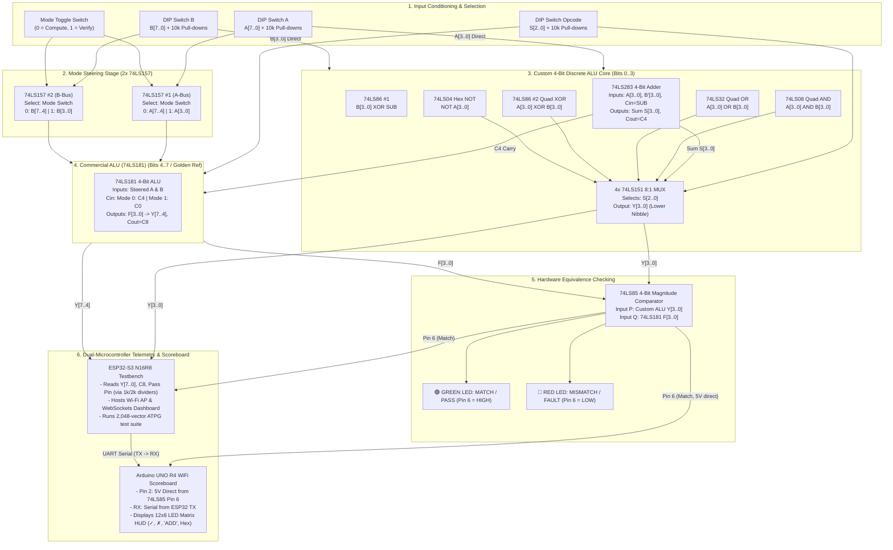

# Complete Hardware Circuit Schematic & Netlist
## Dual-Mode 8-Bit Reconfigurable ALU with 74LS181 Golden Reference, ESP32-S3 Testbench & Arduino R4 Scoreboard

---

## 1. High-Level Architectural Schematic



---

## 2. Detailed Circuit Schematic with Exact IC Pin Numbers

### Stage A: Input Pull-Down Conditioning & Opcode Decoding
Every mechanical switch contact connects to $+5\text{ V}$. When the switch is open, the $10\text{ k}\Omega$ pull-down resistor holds the input line reliably at $0\text{ V}$ ($\text{LOW}$).

```
+5V ────────┬───────────┬───────────┬───────────┬───────────┬───────────┬───────────┬───────────┐
            │           │           │           │           │           │           │           │
          [SW A0]     [SW A1]     [SW A2]     [SW A3]     [SW B0]     [SW B1]     [SW B2]     [SW B3]
            │           │           │           │           │           │           │           │
            ├─► A0      ├─► A1      ├─► A2      ├─► A3      ├─► B0      ├─► B1      ├─► B2      ├─► B3
            │           │           │           │           │           │           │           │
          [10k]       [10k]       [10k]       [10k]       [10k]       [10k]       [10k]       [10k]
            │           │           │           │           │           │           │           │
GND ────────┴───────────┴───────────┴───────────┴───────────┴───────────┴───────────┴───────────┘
```

Subtraction Control Logic ($SUB$):
$$SUB = \overline{S_2} \cdot \overline{S_1} \cdot S_0$$
*(Active only when Opcode = `001`)*.

---

### Stage B: Custom 4-Bit Arithmetic Core (74LS283 + 74LS86 #1)

```
                     SUB Signal (from Opcode S0 in Subtraction mode)
                           │
       ┌───────────────────┼───────────────────┬───────────────────┬───────────────────┐
       │                   │                   │                   │                   │
       ▼ (Pin 1)           ▼ (Pin 4)           ▼ (Pin 10)          ▼ (Pin 13)          │
 ┌───────────┐       ┌───────────┐       ┌───────────┐       ┌───────────┐             │
 │ 74LS86 #1 │       │ 74LS86 #1 │       │ 74LS86 #1 │       │ 74LS86 #1 │             │
 │ XOR Gate1 │       │ XOR Gate2 │       │ XOR Gate3 │       │ XOR Gate4 │             │
 └─────┬─────┘       └─────┬─────┘       └─────┬─────┘       └─────┬─────┘             │
       ▲ (Pin 2)           ▲ (Pin 5)           ▲ (Pin 9)           ▲ (Pin 12)          │
       │ B0                │ B1                │ B2                │ B3                │
       │                   │                   │                   │                   │
       ▼ (Pin 3: B'0)      ▼ (Pin 6: B'1)      ▼ (Pin 8: B'2)      ▼ (Pin 11: B'3)     │
       │                   │                   │                   │                   │
       │   A0 (Pin 10)     │   A1 (Pin 15)     │   A2 (Pin 3)      │   A3 (Pin 7)      │
       │   │               │   │               │   │               │   │               │
       ▼   ▼               ▼   ▼               ▼   ▼               ▼   ▼               ▼
 ┌────────────────────────────────────────────────────────────────────────────────────────┐
 │                               74LS283 4-BIT BINARY ADDER                               │
 │ Pin 16: VCC (+5V) | Pin 5: VCC (+5V) | Pin 8: GND | Pin 12: Carry-In (Cin = SUB)       │
 └───────┬───────────────────┬───────────────────┬───────────────────┬────────────────┬───┘
         │ Pin 13 (S0)       │ Pin 1 (S1)        │ Pin 4 (S2)        │ Pin 1 (S3)     │ Pin 9 (Cout = C4)
         ▼                   ▼                   ▼                   ▼                ▼
     Sum Bit 0           Sum Bit 1           Sum Bit 2           Sum Bit 3        Carry to 74181
    (To MUX0 D0,D1)     (To MUX1 D0,D1)     (To MUX2 D0,D1)     (To MUX3 D0,D1)   (Pin 15)
```

---

### Stage C: 4-Bit Logic Array (74LS08, 74LS32, 74LS86 #2, 74LS04)

For each bit position $k \in \{0, 1, 2, 3\}$:
```
           Ak ─────────────┬─────────────┬─────────────┬─────────────┐
                           │             │             │             │
           Bk ───────┬─────┼───────┬─────┼───────┬─────┼───────┐     │
                     │     │       │     │       │     │       │     │
                     ▼     ▼       ▼     ▼       ▼     ▼       │     ▼
                  ┌─────────┐   ┌─────────┐   ┌─────────┐      │  ┌─────────┐
                  │ 74LS08  │   │ 74LS32  │   │ 74LS86  │      │  │ 74LS04  │
                  │   AND   │   │   OR    │   │ XOR #2  │      │  │   NOT   │
                  └────┬────┘   └────┬────┘   └────┬────┘      │  └────┬────┘
                       │             │             │           │       │
                       ▼             ▼             ▼           │       ▼
                    AND_k         OR_k          XOR_k          │     NOT_k
                  (MUXk D2)     (MUXk D3)     (MUXk D4)        │   (MUXk D5)
```

---

### Stage D: Output Selection Multiplexer Bank (4× 74LS151)

Each of the four 74LS151 ICs selects one bit of the Custom ALU result:
* **MUX 0 (Bit 0)**: Selects $Y_0$
* **MUX 1 (Bit 1)**: Selects $Y_1$
* **MUX 2 (Bit 2)**: Selects $Y_2$
* **MUX 3 (Bit 3)**: Selects $Y_3$

```
                   S0 (LSB) ──────────────── Pin 11 (Select A)
                   S1 (MID) ──────────────── Pin 10 (Select B)
                   S2 (MSB) ──────────────── Pin 9  (Select C)
                        GND ──────────────── Pin 7  (/STROBE Enable)
                        +5V ──────────────── Pin 16 (VCC)
                        GND ──────────────── Pin 8  (GND)

                          ┌───────────────────────┐
                          │   74LS151 (MUX k)     │
       Sum_k (Adder) ────►│ Pin 4  (D0: ADD)      │
       Sum_k (Adder) ────►│ Pin 3  (D1: SUB)      │
       AND_k (7408)  ────►│ Pin 2  (D2: AND)      │
       OR_k  (7432)  ────►│ Pin 1  (D3: OR)       ├────► Pin 5 (Output Y_k)
       XOR_k (7486)  ────►│ Pin 15 (D4: XOR)      │      (To 74LS85 Comparator
       NOT_k (7404)  ────►│ Pin 14 (D5: NOT)      │       & ESP32 Pin via divider)
       INC_k (Logic) ────►│ Pin 13 (D6: INC)      │
                 GND ────►│ Pin 12 (D7: CLEAR)    │
                          └───────────────────────┘
```

---

### Stage E: Hardware Equivalence Verifier (74LS85 Comparator)

```
    Custom ALU Outputs                         74LS181 Outputs
    (Lower Nibble Y3..Y0)                     (Upper/Ref Nibble F3..F0)
       │   │   │   │                             │   │   │   │
       ▼   ▼   ▼   ▼                             ▼   ▼   ▼   ▼
       Y0  Y1  Y2  Y3                            F0  F1  F2  F3
       │   │   │   │                             │   │   │   │
   (Pin 10 12  13  15)                        (Pin 9   11  14  1)
   ┌───┴───┴───┴───┴─────────────────────────────┴───┴───┴───┴───┐
   │                 74LS85 4-BIT COMPARATOR                      │
   │ Cascading: Pin 3 (I_A=B) -> +5V | Pin 2, 4 -> GND            │
   │ Power: Pin 16 -> +5V | Pin 8 -> GND                          │
   └──────────────────────────────┬───────────────────────────────┘
                                  │ Pin 6 (A = B Output)
                                  ├───────────────────────────────┐
                                  │                               │
                                  ▼                               ▼
                            [ 330 Ohm ]                   [ 74LS04 Inverter ]
                                  │                               │
                                  ▼                               ▼
                            🟢 GREEN LED                    [ 330 Ohm ]
                            "PASS / MATCH"                        │
                                  │                               ▼
                                  ▼                          🔴 RED LED
                                 GND                       "MISMATCH / FAULT"
                                                                  │
                                                                  ▼
                                                                 GND
                                  │
                                  └─────────► Arduino UNO R4 (Pin 2: 5V direct)
                                  └─────────► ESP32-S3 (GPIO 38 via 1k/2k divider)
```

---

### Stage F: ESP32-S3 Resistor Voltage Dividers (5V $\to$ 3.3V Protection)

Every 5V output signal line coming from the breadboard ICs ($Y_0..Y_7$, Carry, Pass) passes through this simple 2-resistor divider before entering an ESP32-S3 GPIO pin:

```
From 74LS IC Output (5.0V) ───────[ 1.0 kΩ ]───────┬───────► To ESP32-S3 GPIO (3.3V Safe)
                                                   │
                                              [ 2.2 kΩ ]
                                                   │
                                                  GND
```
* **Calculation**: $V_{out} = 5.0\text{ V} \times \frac{2.2\text{ k}\Omega}{1.0\text{ k}\Omega + 2.2\text{ k}\Omega} = 3.43\text{ V}$ (completely safe for the ESP32 clamp diodes and recognized as valid logic HIGH).

---

## 3. Complete Pin-to-Pin Wiring Netlist (Breadboard Assembly Table)

| Wire # | From (Source Pin) | To (Destination Pin) | Signal Function | Wire Color Recommendation |
| :---: | :--- | :--- | :--- | :--- |
| **W1** | +5V Power Supply | Breadboard Top & Bottom Red Rails | $V_{CC}$ (+5V) | Red |
| **W2** | GND Power Supply | Breadboard Top & Bottom Blue Rails | System Ground | Black |
| **W3** | 74LS283 Pin 16, 5 | +5V Rail | Adder Power | Red |
| **W4** | 74LS283 Pin 8 | GND Rail | Adder Ground | Black |
| **W5** | 74LS283 Pin 12 | Opcode Switch $S_0$ (via SUB line) | Adder Carry In ($C_{in}$) | Yellow |
| **W6** | 74LS283 Pin 10, 15, 3, 7 | Operand A Switches $A_0, A_1, A_2, A_3$ | Operand A Inputs | Blue |
| **W7** | 74LS86 #1 Pins 3, 6, 8, 11 | 74LS283 Pins 11, 2, 14, 6 | Inverted $B'_0..B'_3$ | Green |
| **W8** | 74LS283 Pins 13, 1, 4, 1 | MUX 0..3 Pins 4 & 3 ($D_0, D_1$) | Sum Bits $S_0..S_3$ | Green |
| **W9** | 74LS283 Pin 9 ($C_4$) | 74LS181 Pin 15 ($\overline{C_n}$) | Intermediate Carry | Yellow |
| **W10** | 74LS08 Pins 3, 6, 8, 11 | MUX 0..3 Pin 2 ($D_2$) | AND Results | White |
| **W11** | 74LS32 Pins 3, 6, 8, 11 | MUX 0..3 Pin 1 ($D_3$) | OR Results | White |
| **W12** | 74LS86 #2 Pins 3, 6, 8, 11 | MUX 0..3 Pin 15 ($D_4$) | XOR Results | White |
| **W13** | 74LS04 Pins 2, 4, 6, 8 | MUX 0..3 Pin 14 ($D_5$) | NOT Results | White |
| **W14** | MUX 0..3 Pin 12 ($D_7$) | GND Rail | CLEAR (Constant 0) | Black |
| **W15** | MUX 0..3 Pin 7 ($\overline{E}$) | GND Rail | MUX Enable (Active Low) | Black |
| **W16** | MUX 0..3 Pins 11, 10, 9 | Opcode Switches $S_0, S_1, S_2$ | Operation Select | Yellow |
| **W17** | MUX 0..3 Pin 5 (Outputs $Y_0..Y_3$) | 74LS85 Pins 10, 12, 13, 15 | Custom ALU $\to$ Comparator | Blue |
| **W18** | 74LS181 Pins 9, 10, 11, 14 | 74LS85 Pins 9, 11, 14, 1 | 74LS181 $\to$ Comparator | Purple |
| **W19** | 74LS85 Pin 3 ($I_{A=B}$) | +5V Rail | Comparator Initial Condition | Red |
| **W20** | 74LS85 Pin 2, 4 | GND Rail | Comparator Unused Inputs | Black |
| **W21** | 74LS85 Pin 6 ($O_{A=B}$) | 330 Ω Resistor $\to$ Green PASS LED | Hardware PASS Indicator | Green |
| **W22** | 74LS85 Pin 6 ($O_{A=B}$) | Arduino UNO R4 Pin 2 | Scoreboard Pass Input | Green |
| **W23** | ESP32-S3 GPIO 18 (TX) | Arduino UNO R4 Pin 0 (RX) | Multi-MCU Serial Link | Orange |
| **W24** | ESP32-S3 GND | Arduino UNO R4 GND | Common Ground | Black |
