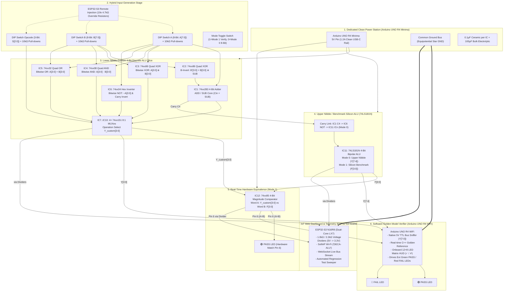

# Complete Hardware Circuit Schematic & Netlist
## Dual-Mode Discrete & Silicon ALU Processor (74xx Discrete + 74LS181N + 74xx85)
### Heterogeneous 3-Board Infrastructure: ESP32-S3 N16R8, Arduino UNO R4 WiFi & Arduino UNO R4 Minima

This document provides the exhaustive hardware circuit schematics, ASCII circuit blueprints, operational data flows, and a complete pin-by-pin netlist for the **Dual-Mode Discrete & Silicon ALU Processor**.

---

## 1. Master System Block Diagram



---

## 2. Complete ASCII Hardware Schematics

### 2.1 Subsystem 1: Power Station & Star Ground Distribution
* **Arduino UNO R4 Minima**: Provides dedicated +5V DC @ up to 1.2A via high-current USB-C.
* **Grounding Topology**: Single equipotential star ground eliminating ground loops.

```
   USB-C Input (5V 3A)
         │
         ▼
  ┌─────────────────────────┐
  │  ARDUINO UNO R4 MINIMA  │
  │  (Dedicated Clean PS)   │
  │                         │
  │   5V Pin ───────────────┼─────► [ +5V MASTER POWER RAIL ] (All Breadboards)
  │                         │            │             │
  │                         │         [100µF]       [0.1µF]  (Across every IC VCC/GND)
  │                         │            │             │
  │  GND Pin ───────────────┼─────► [ COMMON GND RAIL ] (0V Reference)
  └─────────────────────────┘            │
                                         ├────────────────────────┐
                                         │                        │
  ┌─────────────────────────┐            │         ┌─────────────────────────┐
  │  ARDUINO UNO R4 WIFI    │            │         │  ESP32-S3 N16R8         │
  │  (Verifier & 12x8 HUD)  │            │         │  (Web Dashboard & AP)   │
  │                         │            │         │                         │
  │  GND Pin ───────────────┴────────────┘         │  GND Pin ───────────────┘
  │  (5V Pin UNCONNECTED!)                         │  (5V Pin UNCONNECTED!)
  └─────────────────────────┘                      └─────────────────────────┘
```

---

### 2.2 Subsystem 2: Hybrid Input Stage (Tactile DIPs + ESP32 Override)
Each of the 20 input lines ($A[7:0], B[7:0], S[2:0], \text{MODE}$) features this identical topology:

```
                  +5V Master Rail
                         │
                         ▼
                   [ DIP Switch ]
                         │
  ESP32 GPIO ────[ 4.7kΩ Override ]────┬─────► Driven Node (ALU Input Pin)
                                       │
                                [ 10kΩ Pull-down ]
                                       │
                                       ▼
                                  Common GND
```

#### Truth & Voltage Verification:
- **DIP = OFF, ESP32 = Tri-State (INPUT)**: $V_{node} = 0.0\text{V}$ (Logic LOW).
- **DIP = ON, ESP32 = Tri-State (INPUT)**: $V_{node} = +5.0\text{V}$ (Logic HIGH).
- **DIP = OFF, ESP32 = Driving HIGH (3.3V)**:
  $$V_{node} = 3.3\text{ V} \times \frac{10\text{ k}\Omega}{4.7\text{ k}\Omega + 10\text{ k}\Omega} = 2.245\text{ V} > V_{IH,\min} (2.0\text{ V}) \implies \text{Logic HIGH}$$
- **DIP = ON (+5V), ESP32 = Driving LOW (0V)**: Contention current $I = 5\text{V} / 4.7\text{k}\Omega = 1.06\text{ mA} < 40\text{ mA}$ limit (Safe!).

---

### 2.3 Subsystem 3: Lower Nibble Custom 4-Bit ALU Slice (IC1..IC6)

```
                       SUB (Opcode S0 when Opcode 001)
                        │
                        ├──────────────────────────┐
                        │                          │
                        ▼                          ▼
                 ┌─────────────┐            ┌─────────────┐
        B0 ─────►│ 1A       1Y ├──── B'0 ──►│ B1       Σ0 ├───► MUX0 D0, D1 (IC7 Pins 4,3)
                 │  IC2: 7486  │            │             │
        B1 ─────►│ 2A       2Y ├──── B'1 ──►│ B2       Σ1 ├───► MUX1 D0, D1 (IC8 Pins 4,3)
                 │ (B-Invert)  │            │  IC1: 74283 │
        B2 ─────►│ 3A       3Y ├──── B'2 ──►│ B3 (4-Bit)  │
                 │             │            │    Adder    │
        B3 ─────►│ 4A       4Y ├──── B'3 ──►│ B4       Σ2 ├───► MUX2 D0, D1 (IC9 Pins 4,3)
                 └─────────────┘            │             │
        A0 ────────────────────────────────►│ A1       Σ3 ├───► MUX3 D0, D1 (IC10 Pins 4,3)
        A1 ────────────────────────────────►│ A2          │
        A2 ────────────────────────────────►│ A3       C4 ├───► Carry Out (IC1 Pin 9)
        A3 ────────────────────────────────►│ A4       C0 │      │
                                            └──────┬──────┘      ▼
                                                   ▲      ┌──────────────┐
                                                   │      │ IC6: 74xx04  │
                                                   └──────┤ Pin 11 -> 10 ├─► /Cn (Cascaded Carry)
                                                          └──────────────┘

  --- Bitwise Logic Array ---
        A[3:0] ──┬──────────┬──────────┬──────────┐
                 │          │          │          │
        B[3:0] ──┼──────────┼──────────┼──────────┤
                 ▼          ▼          ▼          ▼
            ┌─────────┐┌─────────┐┌─────────┐┌─────────┐
            │IC4: 7408││IC5: 7432││IC3: 7486││IC6: 7404│
            │(AND Gate││(OR Gate)││(XOR Gate││(NOT Gate│
            └────┬────┘└────┬────┘└────┬────┘└────┬────┘
                 │          │          │          │
                 ▼ (D2)     ▼ (D3)     ▼ (D4)     ▼ (D5)
             Bitwise    Bitwise    Bitwise    Bitwise
               AND        OR         XOR        NOT
```

---

### 2.4 Subsystem 4: Multiplexer Array (IC7..IC10 4× 74xx151 8:1 MUXes)
Every bit-slice $i \in \{0, 1, 2, 3\}$ uses one 74xx151:

```
                 Opcode Bus S[2..0]
                        │
                        ├───────────────────────┐
                        ▼ (Pins 9, 10, 11)      │
               ┌───────────────────┐            │
     Adder Σi ─┤ 4  D0           5 ├─ Yi        │
      Diff Σi ─┤ 3  D1             │            ▼ (Identical for IC8, IC9, IC10)
     AND Ai·Bi ┤ 2  D2   74xx151   │
     OR  Ai+Bi ┤ 1  D3   (IC7)     │
    XOR  Ai⊕Bi ┤ 15 D4             │
     NOT   ~Ai ┤ 14 D5             │
    SHL  Ai-1  ┤ 13 D6             │
    SHR  Ai+1  ┤ 12 D7   /E=GND(7) │
               └───────────────────┘
```

#### Shift Bus Routing:
- **Bit 0 (IC7)**: $D_6$ (SHL) $\to$ GND; $D_7$ (SHR) $\to A_1$.
- **Bit 1 (IC8)**: $D_6$ (SHL) $\to A_0$; $D_7$ (SHR) $\to A_2$.
- **Bit 2 (IC9)**: $D_6$ (SHL) $\to A_1$; $D_7$ (SHR) $\to A_3$.
- **Bit 3 (IC10)**: $D_6$ (SHL) $\to A_2$; $D_7$ (SHR) $\to$ GND (Mode 1) / $A_4$ (Mode 0).

---

### 2.5 Subsystem 5: 74LS181N Silicon ALU Core (IC11)

```
                     Mode Switch
                          │
          ┌───────────────┴───────────────┐
          │ (MODE = 0: 8-Bit)             │ (MODE = 1: Verify)
          ▼                               ▼
    Operands A[7:4], B[7:4]         Operands A[3:0], B[3:0]
    Carry In /Cn = IC6 Pin 10 (/C4) Carry In /Cn = +5V (No carry)
          │                               │
          └───────────────┬───────────────┘
                          │
                          ▼
            ┌───────────────────────────┐
            │      IC11: 74LS181N       │
            │  4-Bit Silicon ALU IC     │
            │                           │
            │  Pins 2,19,21,23: Inputs A│
            │  Pins 1,20,22,24: Inputs B│
            │  Pins 3,4,5,6: S3,S2,S1,S0│
            │  Pin 8: Mode Control M    │
            │  Pin 7: Carry In /Cn      │
            │                           │
            │  Pins 9,10,11,13: F0..F3  │
            │  Pin 18: Carry Out /Cn+4  │
            └─────────────┬─────────────┘
                          │
          ┌───────────────┴───────────────┐
          │                               │
          ▼ (MODE = 0)                    ▼ (MODE = 1)
     Upper 4-Bit Bus                Benchmark Word B to IC12
     Outputs Y[7:4]                 Pins 9, 11, 14, 1 (B0..B3)
```

---

### 2.6 Subsystem 6: Hardware Equivalence Comparator (IC12 74xx85)

```
      Custom ALU Outputs Y[3:0]          74LS181 Silicon Outputs F[3:0]
      (IC7..IC10 Pin 5)                  (IC11 Pins 9, 10, 11, 13)
             │                                   │
             ▼                                   ▼
      Pins 10, 12, 13, 15                 Pins 9, 11, 14, 1
      (Word A: A0, A1, A2, A3)            (Word B: B0, B1, B2, B3)
             │                                   │
             └───────────────┬───────────────────┘
                             │
                             ▼
              ┌─────────────────────────────┐
              │   IC12: 74xx85 COMPARATOR   │
              │                             │
              │  Pin 3 (I A=B) ◄─── +5V     │
              │  Pin 2 (I A<B) ◄─── GND     │
              │  Pin 4 (I A>B) ◄─── GND     │
              │                             │
              │  Pin 6 (Q A=B) ─────────────┼────────┐
              └─────────────────────────────┘        │
                                                     │
                             ┌───────────────────────┴───────────────────────┐
                             │                                               │
                             ▼                                               ▼
                      [ 330Ω Resistor ]                              Arduino UNO R4 WiFi
                             │                                       Pin D12 (5V Direct Read)
                             ▼                                               │
                      [ 🟢 GREEN PASS ]                                      ▼
                      [ SILICON MATCH ]                              ESP32-S3 GPIO 3
                             │                                       (via 1k/2.2k Divider)
                             ▼
                         Common GND
```

---

### 2.7 Subsystem 7 & 8: Dual-MCU Verification & IoT Telemetry Interface

```
  =============================================================================
             ARDUINO UNO R4 WIFI (5V Software Golden Model Oracle)
  =============================================================================
  Direct 5V TTL Inputs (No dividers required):
    Digital Pin D2  ◄────── Y0 (Custom ALU Bit 0 / IC7 Pin 5)
    Digital Pin D3  ◄────── Y1 (Custom ALU Bit 1 / IC8 Pin 5)
    Digital Pin D4  ◄────── Y2 (Custom ALU Bit 2 / IC9 Pin 5)
    Digital Pin D5  ◄────── Y3 (Custom ALU Bit 3 / IC10 Pin 5)
    Digital Pin D6  ◄────── Y4 (74LS181 Bit 0 / IC11 Pin 9)
    Digital Pin D7  ◄────── Y5 (74LS181 Bit 1 / IC11 Pin 10)
    Digital Pin D8  ◄────── Y6 (74LS181 Bit 2 / IC11 Pin 11)
    Digital Pin D9  ◄────── Y7 (74LS181 Bit 3 / IC11 Pin 13)
    Digital Pin D12 ◄────── IC12 Pin 6 (Hardware A=B Equivalence Flag)
    Analog Pin A0   ◄────── Opcode S0
    Analog Pin A1   ◄────── Opcode S1
    Analog Pin A2   ◄────── Opcode S2
    Analog Pin A3   ◄────── MODE Switch Line
  Outputs:
    Digital Pin D10 ──────► [ 220Ω ] ──► 🟢 PASS LED (Software Oracle Match)
    Digital Pin D11 ──────► [ 220Ω ] ──► 🔴 FAIL LED (Software Mismatch)
    Onboard Matrix  ──────► Animated 12×8 HUD ('✓' / '✗' / Opcode)

  =============================================================================
             ESP32-S3 N16R8 (IoT Web Dashboard & Remote Vector Injection)
  =============================================================================
  Hybrid Injection Lines (via 4.7kΩ Override Resistors):
    GPIO 1, 2, 4, 5, 6, 7, 8, 9   ──────► Input Bus A[7:0]
    GPIO 10, 11, 12, 13, 14, 15, 16, 17 ─► Input Bus B[7:0]
    GPIO 18, 35, 36               ──────► Opcode Bus S[2:0]
    GPIO 37                       ──────► Mode Select Line
  Telemetry Monitor Lines (via 1.0kΩ / 2.2kΩ Voltage Dividers to 3.3V):
    GPIO 38, 39, 40, 41           ◄────── Result Bus Y[3:0]
    GPIO 42, 47, 48, 21           ◄────── Result Bus Y[7:4]
    GPIO 3                        ◄────── IC12 Pin 6 (Hardware Equivalence Flag)
```

---

## 3. Complete Exhaustive Netlist

### 3.1 Power & Ground Nets
| Net Name | Origin Source | Destination Pins / Components | Function |
| :--- | :--- | :--- | :--- |
| **+5V_MASTER** | Arduino UNO R4 Minima 5V Pin | IC1 Pin 16, IC2 Pin 14, IC3 Pin 14, IC4 Pin 14, IC5 Pin 14, IC6 Pin 14, IC7 Pin 16, IC8 Pin 16, IC9 Pin 16, IC10 Pin 16, IC11 Pin 16 (or 24), IC12 Pin 16, IC12 Pin 3 ($I_{A=B}$), DIP Switch Common Rails, $100\ \mu\text{F}$ Electrolytic (+) | System +5V logic supply rail |
| **COMMON_GND** | Arduino UNO R4 Minima GND Pin | IC1 Pin 8, IC2 Pin 7, IC3 Pin 7, IC4 Pin 7, IC5 Pin 7, IC6 Pin 7, IC7 Pins 7 & 8, IC8 Pins 7 & 8, IC9 Pins 7 & 8, IC10 Pins 7 & 8, IC11 Pin 12, IC12 Pins 2, 4, 8, Arduino UNO R4 WiFi GND, ESP32-S3 GND, all 10kΩ pull-downs, all 2.2kΩ divider shunts, LED cathodes, $100\ \mu\text{F}$ Electrolytic (-) | Unified 0V star ground plane |

---

### 3.2 Input Operand A Bus Nets
| Net Name | Primary Source | Secondary Source | Destination Pins | Description |
| :--- | :--- | :--- | :--- | :--- |
| **NET_A0** | DIP SW A Bit 0 | ESP32 GPIO 1 (4.7kΩ) | IC1 Pin 5 ($A_1$), IC3 Pin 1 (1A), IC4 Pin 1 (1A), IC5 Pin 1 (1A), IC6 Pin 1 (1A), IC8 Pin 13 ($D_6$), IC11 Pin 2 (Mode 1) | Operand A Bit 0 |
| **NET_A1** | DIP SW A Bit 1 | ESP32 GPIO 2 (4.7kΩ) | IC1 Pin 3 ($A_2$), IC3 Pin 4 (2A), IC4 Pin 4 (2A), IC5 Pin 4 (2A), IC6 Pin 3 (2A), IC7 Pin 12 ($D_7$), IC9 Pin 13 ($D_6$), IC11 Pin 19 (Mode 1) | Operand A Bit 1 |
| **NET_A2** | DIP SW A Bit 2 | ESP32 GPIO 4 (4.7kΩ) | IC1 Pin 14 ($A_3$), IC3 Pin 9 (3A), IC4 Pin 9 (3A), IC5 Pin 9 (3A), IC6 Pin 5 (3A), IC8 Pin 12 ($D_7$), IC10 Pin 13 ($D_6$), IC11 Pin 21 (Mode 1) | Operand A Bit 2 |
| **NET_A3** | DIP SW A Bit 3 | ESP32 GPIO 5 (4.7kΩ) | IC1 Pin 12 ($A_4$), IC3 Pin 12 (4A), IC4 Pin 12 (4A), IC5 Pin 12 (4A), IC6 Pin 9 (4A), IC9 Pin 12 ($D_7$), IC11 Pin 23 (Mode 1) | Operand A Bit 3 |
| **NET_A4** | DIP SW A Bit 4 | ESP32 GPIO 6 (4.7kΩ) | IC11 Pin 2 ($\bar{A}_0$, Mode 0), IC10 Pin 12 ($D_7$, Mode 0) | Operand A Bit 4 |
| **NET_A5** | DIP SW A Bit 5 | ESP32 GPIO 7 (4.7kΩ) | IC11 Pin 19 ($\bar{A}_1$, Mode 0) | Operand A Bit 5 |
| **NET_A6** | DIP SW A Bit 6 | ESP32 GPIO 8 (4.7kΩ) | IC11 Pin 21 ($\bar{A}_2$, Mode 0) | Operand A Bit 6 |
| **NET_A7** | DIP SW A Bit 7 | ESP32 GPIO 9 (4.7kΩ) | IC11 Pin 23 ($\bar{A}_3$, Mode 0) | Operand A Bit 7 |

---

### 3.3 Input Operand B Bus & Conditioned B' Nets
| Net Name | Origin | Conditioning Gate | Destination Pins | Description |
| :--- | :--- | :--- | :--- | :--- |
| **NET_B0** | DIP SW B Bit 0 | Direct | IC2 Pin 1 (1A), IC3 Pin 2 (1B), IC4 Pin 2 (1B), IC5 Pin 2 (1B), IC11 Pin 1 (Mode 1) | Operand B Bit 0 raw |
| **NET_B0_COND**| IC2 Pin 3 (1Y) | $B_0 \oplus SUB$ | IC1 Pin 6 ($B_1$) | Conditioned Operand B Bit 0 |
| **NET_B1** | DIP SW B Bit 1 | Direct | IC2 Pin 4 (2A), IC3 Pin 5 (2B), IC4 Pin 5 (2B), IC5 Pin 5 (2B), IC11 Pin 20 (Mode 1) | Operand B Bit 1 raw |
| **NET_B1_COND**| IC2 Pin 6 (2Y) | $B_1 \oplus SUB$ | IC1 Pin 2 ($B_2$) | Conditioned Operand B Bit 1 |
| **NET_B2** | DIP SW B Bit 2 | Direct | IC2 Pin 9 (3A), IC3 Pin 10 (3B), IC4 Pin 10 (3B), IC5 Pin 10 (3B), IC11 Pin 22 (Mode 1) | Operand B Bit 2 raw |
| **NET_B2_COND**| IC2 Pin 8 (3Y) | $B_2 \oplus SUB$ | IC1 Pin 15 ($B_3$) | Conditioned Operand B Bit 2 |
| **NET_B3** | DIP SW B Bit 3 | Direct | IC2 Pin 12 (4A), IC3 Pin 13 (4B), IC4 Pin 13 (4B), IC5 Pin 13 (4B), IC11 Pin 24 (Mode 1) | Operand B Bit 3 raw |
| **NET_B3_COND**| IC2 Pin 11 (4Y)| $B_3 \oplus SUB$ | IC1 Pin 11 ($B_4$) | Conditioned Operand B Bit 3 |
| **NET_B4** | DIP SW B Bit 4 | Direct | IC11 Pin 1 ($\bar{B}_0$, Mode 0) | Operand B Bit 4 |
| **NET_B5** | DIP SW B Bit 5 | Direct | IC11 Pin 20 ($\bar{B}_1$, Mode 0) | Operand B Bit 5 |
| **NET_B6** | DIP SW B Bit 6 | Direct | IC11 Pin 22 ($\bar{B}_2$, Mode 0) | Operand B Bit 6 |
| **NET_B7** | DIP SW B Bit 7 | Direct | IC11 Pin 24 ($\bar{B}_3$, Mode 0) | Operand B Bit 7 |

---

### 3.4 Control, Opcode & Mode Nets
| Net Name | Primary Source | Secondary Source | Destination Pins | Description |
| :--- | :--- | :--- | :--- | :--- |
| **NET_OPCODE_S0** | DIP SW Op Bit 0 | ESP32 GPIO 18 (4.7kΩ) | IC7 Pin 11, IC8 Pin 11, IC9 Pin 11, IC10 Pin 11, Arduino A0, $SUB$ Net | Opcode Bit 0 (LSB) |
| **NET_OPCODE_S1** | DIP SW Op Bit 1 | ESP32 GPIO 35 (4.7kΩ) | IC7 Pin 10, IC8 Pin 10, IC9 Pin 10, IC10 Pin 10, Arduino A1 | Opcode Bit 1 |
| **NET_OPCODE_S2** | DIP SW Op Bit 2 | ESP32 GPIO 36 (4.7kΩ) | IC7 Pin 9, IC8 Pin 9, IC9 Pin 9, IC10 Pin 9, Arduino A2 | Opcode Bit 2 (MSB) |
| **NET_SUB** | Opcode S0 Line | Conditioning | IC1 Pin 7 ($C_0$), IC2 Pins 2, 5, 10, 13 (1B, 2B, 3B, 4B) | Subtraction Control Line ($SUB=1$) |
| **NET_MODE** | Mode Switch Pin | ESP32 GPIO 37 (4.7kΩ) | Steering Multiplexers / Jumpers, Arduino A3 | Datapath Mode: 0 = 8-Bit, 1 = Verify |
| **NET_CASCADE_C4**| IC1 Pin 9 ($C_4$) | IC1 Carry Out | IC6 Pin 11 (5A) | Raw Carry-out from Lower Nibble Adder |
| **NET_CASCADE_CN**| IC6 Pin 10 (5Y) | Inverted Carry | IC11 Pin 7 ($\bar{C}_n$, active LOW carry in for 74LS181) | Inverted Carry to Upper Nibble in Mode 0 |

---

### 3.5 Custom 4-Bit ALU Internal Function Nets
| Net Name | Source Pin | Destination Pin | Logic Function |
| :--- | :--- | :--- | :--- |
| **NET_SUM_0** | IC1 Pin 4 ($\Sigma_0$) | IC7 Pin 4 ($D_0$) & Pin 3 ($D_1$) | Addition/Subtraction Bit 0 |
| **NET_SUM_1** | IC1 Pin 1 ($\Sigma_1$) | IC8 Pin 4 ($D_0$) & Pin 3 ($D_1$) | Addition/Subtraction Bit 1 |
| **NET_SUM_2** | IC1 Pin 13 ($\Sigma_2$) | IC9 Pin 4 ($D_0$) & Pin 3 ($D_1$) | Addition/Subtraction Bit 2 |
| **NET_SUM_3** | IC1 Pin 10 ($\Sigma_3$) | IC10 Pin 4 ($D_0$) & Pin 3 ($D_1$) | Addition/Subtraction Bit 3 |
| **NET_AND_0** | IC4 Pin 3 (1Y) | IC7 Pin 2 ($D_2$) | Bitwise AND Bit 0 ($A_0 \cdot B_0$) |
| **NET_AND_1** | IC4 Pin 6 (2Y) | IC8 Pin 2 ($D_2$) | Bitwise AND Bit 1 ($A_1 \cdot B_1$) |
| **NET_AND_2** | IC4 Pin 8 (3Y) | IC9 Pin 2 ($D_2$) | Bitwise AND Bit 2 ($A_2 \cdot B_2$) |
| **NET_AND_3** | IC4 Pin 11 (4Y) | IC10 Pin 2 ($D_2$) | Bitwise AND Bit 3 ($A_3 \cdot B_3$) |
| **NET_OR_0** | IC5 Pin 3 (1Y) | IC7 Pin 1 ($D_3$) | Bitwise OR Bit 0 ($A_0 + B_0$) |
| **NET_OR_1** | IC5 Pin 6 (2Y) | IC8 Pin 1 ($D_3$) | Bitwise OR Bit 1 ($A_1 + B_1$) |
| **NET_OR_2** | IC5 Pin 8 (3Y) | IC9 Pin 1 ($D_3$) | Bitwise OR Bit 2 ($A_2 + B_2$) |
| **NET_OR_3** | IC5 Pin 11 (4Y) | IC10 Pin 1 ($D_3$) | Bitwise OR Bit 3 ($A_3 + B_3$) |
| **NET_XOR_0** | IC3 Pin 3 (1Y) | IC7 Pin 15 ($D_4$) | Bitwise XOR Bit 0 ($A_0 \oplus B_0$) |
| **NET_XOR_1** | IC3 Pin 6 (2Y) | IC8 Pin 15 ($D_4$) | Bitwise XOR Bit 1 ($A_1 \oplus B_1$) |
| **NET_XOR_2** | IC3 Pin 8 (3Y) | IC9 Pin 15 ($D_4$) | Bitwise XOR Bit 2 ($A_2 \oplus B_2$) |
| **NET_XOR_3** | IC3 Pin 11 (4Y) | IC10 Pin 15 ($D_4$) | Bitwise XOR Bit 3 ($A_3 \oplus B_3$) |
| **NET_NOT_0** | IC6 Pin 2 (1Y) | IC7 Pin 14 ($D_5$) | Bitwise NOT Bit 0 ($\overline{A_0}$) |
| **NET_NOT_1** | IC6 Pin 4 (2Y) | IC8 Pin 14 ($D_5$) | Bitwise NOT Bit 1 ($\overline{A_1}$) |
| **NET_NOT_2** | IC6 Pin 6 (3Y) | IC9 Pin 14 ($D_5$) | Bitwise NOT Bit 2 ($\overline{A_2}$) |
| **NET_NOT_3** | IC6 Pin 8 (4Y) | IC10 Pin 14 ($D_5$) | Bitwise NOT Bit 3 ($\overline{A_3}$) |

---

### 3.6 Output Bus & Hardware Verification Nets
| Net Name | Primary Source | Destination 1 | Destination 2 | Destination 3 |
| :--- | :--- | :--- | :--- | :--- |
| **NET_Y0** | IC7 Pin 5 (Y) | IC12 Pin 10 ($A_0$) | Arduino R4 D2 | ESP32 GPIO 38 (via 1k/2.2k) |
| **NET_Y1** | IC8 Pin 5 (Y) | IC12 Pin 12 ($A_1$) | Arduino R4 D3 | ESP32 GPIO 39 (via 1k/2.2k) |
| **NET_Y2** | IC9 Pin 5 (Y) | IC12 Pin 13 ($A_2$) | Arduino R4 D4 | ESP32 GPIO 40 (via 1k/2.2k) |
| **NET_Y3** | IC10 Pin 5 (Y) | IC12 Pin 15 ($A_3$) | Arduino R4 D5 | ESP32 GPIO 41 (via 1k/2.2k) |
| **NET_Y4** | IC11 Pin 9 ($\bar{F}_0$) | IC12 Pin 9 ($B_0$, Mode 1) | Arduino R4 D6 | ESP32 GPIO 42 (via 1k/2.2k) |
| **NET_Y5** | IC11 Pin 10 ($\bar{F}_1$) | IC12 Pin 11 ($B_1$, Mode 1) | Arduino R4 D7 | ESP32 GPIO 47 (via 1k/2.2k) |
| **NET_Y6** | IC11 Pin 11 ($\bar{F}_2$) | IC12 Pin 14 ($B_2$, Mode 1) | Arduino R4 D8 | ESP32 GPIO 48 (via 1k/2.2k) |
| **NET_Y7** | IC11 Pin 13 ($\bar{F}_3$) | IC12 Pin 1 ($B_3$, Mode 1) | Arduino R4 D9 | ESP32 GPIO 21 (via 1k/2.2k) |
| **NET_EQUIV_PASS** | IC12 Pin 6 ($Q_{A=B}$) | Green PASS LED (330Ω) | Arduino R4 D12 | ESP32 GPIO 3 (via 1k/2.2k) |
